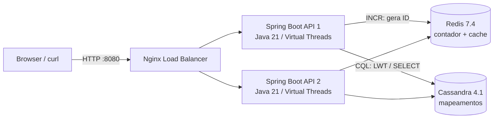
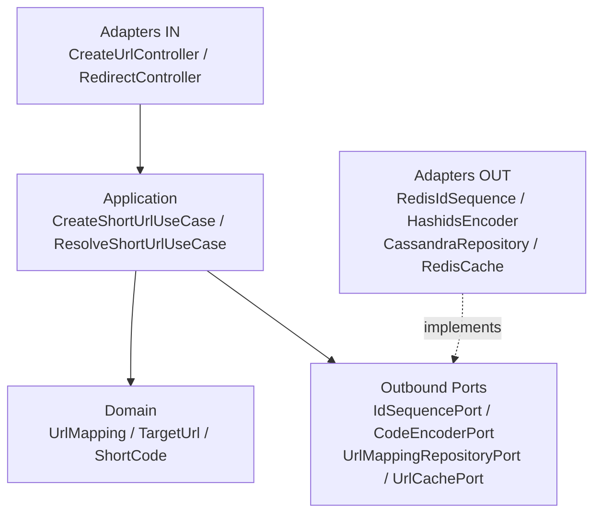
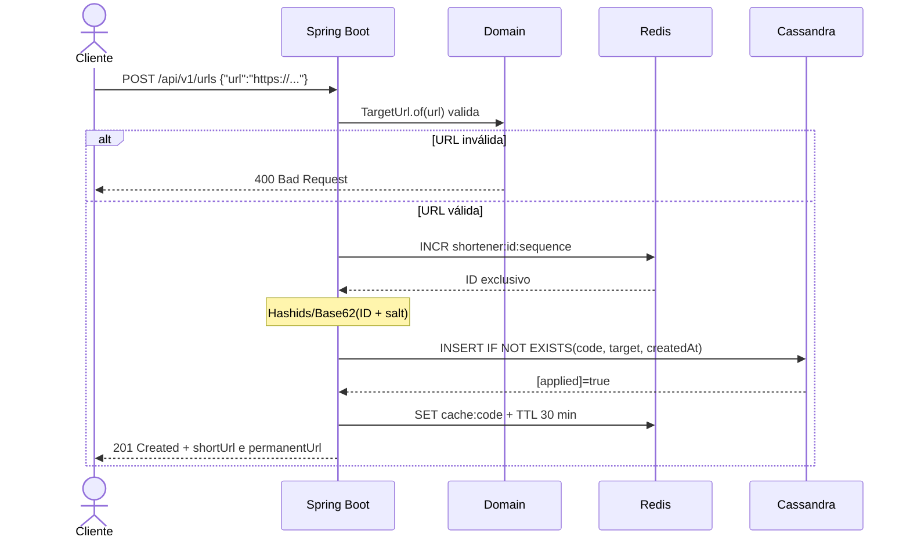
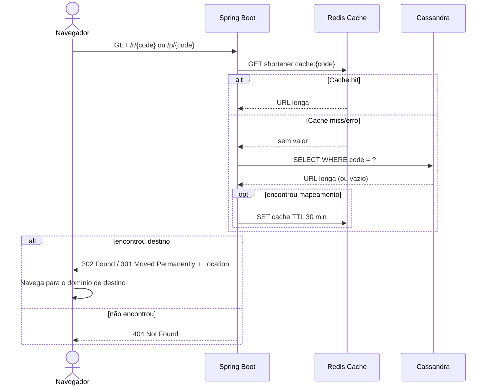

# Laboratório de encurtador de URL — Java 21 + DDD + Clean Architecture

**Stack:** Java 21, Spring Boot 3.5.12, Spring MVC, Virtual Threads, Maven, Redis 7.4, Apache Cassandra 4.1, Nginx e Podman/Podman Compose no Linux Mint.

> Laboratório de **system design** baseado nos requisitos das imagens. O projeto já contém código-fonte, `compose.yaml`, criação do schema, scripts e testes. Não é uma implantação de produção e a meta de 100 milhões de novas URLs/dia é uma **estimativa de dimensionamento**, não uma capacidade comprovada no notebook.

## 1. O problema

Receber uma URL longa, criar um identificador curto e redirecionar o navegador, conservando o mapeamento por pelo menos dez anos no cenário-alvo. Dois contratos de redirecionamento permitem estudar os efeitos semânticos e de cache de **HTTP 302** e **HTTP 301**.

### Contexto de negócio: para quem e por quê?

O laboratório representa um serviço de encurtamento que **poderia** atender plataformas de marketing digital, e-commerce, comunicação corporativa, redes sociais e campanhas com QR codes. Esses são **cenários de uso propostos**, não clientes reais nem funcionalidades comerciais já entregues.

| Necessidade do negócio | Resposta arquitetural | Benefício / limite |
|---|---|---|
| Compartilhar links longos em campanhas e mensagens | Código curto alfanumérico | Links mais fáceis de distribuir |
| Suportar muitos acessos a um mesmo link | Leitura por chave + Redis cache-aside | Menos consultas ao banco quando há cache hit |
| Não redirecionar um código para um destino diferente | Mapeamento imutável + `INSERT ... IF NOT EXISTS` | Protege integridade dos links existentes |
| Escolher semântica de redirecionamento | `/r/{code}` (302) e `/p/{code}` (301) | Controle de cache HTTP conforme o caso de uso |
| Guardar links por longo período | Cassandra sem TTL nos registros | Retenção lógica; backups e SLA ainda não implementados |
| Escalar sem afinidade de sessão | APIs stateless + balanceamento | Possibilita acrescentar instâncias, se a infraestrutura suportar |

**Fora do escopo atual:** autenticação de clientes, painel de campanhas, contagem de cliques, analytics, domínios customizados, monetização, links expirados e prevenção completa de abuso. Não atribuir essas capacidades ao código existente.

### Regras funcionais e de negócio

| ID | Regra | Implementação |
|---|---|---|
| RF-01 | Encurtar URL longa por API REST | `POST /api/v1/urls` devolve HTTP **201** e código curto |
| RF-02 | Visitar link temporário | `GET /r/{code}` devolve **302 Found** com `Location` |
| RF-03 | Visitar link permanente | `GET /p/{code}` devolve **301 Moved Permanently** com `Location` |
| RN-01 | Validar URL ANTES de consumir ID | Value Object `TargetUrl` faz a validação na camada de domínio |
| RN-02 | Aceitar apenas `http://` e `https://` | Bloqueia `javascript:`, `file:`, `ftp:`, `data:` etc. |
| RN-03 | URL deve ter hostname DNS com TLD, sem usuário/senha nem espaços | Rejeita `localhost`, domínios `.local/.internal/.invalid/.test`, IP literal, controle e URLs acima de 2048 bytes |
| RN-04 | Um código não pode substituir outro link | `INSERT ... IF NOT EXISTS` no Cassandra (LWT) + até 5 tentativas |
| RN-05 | Mapeamento **imutável** | Não existe endpoint de edição ou exclusão no laboratório; garante a segurança semântica do 301 |
| RN-06 | Código legível na URL | ID sequencial Redis `INCR` transformado com Hashids/Base62 alfanumérico, mínimo de 8 caracteres |
| RN-07 | Repetir uma URL longa pode gerar códigos diferentes | Não há deduplicação por destino; cada chamada de criação gera um mapeamento novo |
| RN-08 | Consulta deve preferir cache | Redis cache-aside com TTL de 30 minutos; fallback para Cassandra |
| RN-09 | Falha do cache não invalida dado já persistido | Adaptador de cache é *best effort*; Cassandra é fonte de verdade |
| RN-10 | Código desconhecido/inválido | Responder **404**, nunca redirecionar para destino não encontrado |
| RN-11 | URL inválida | Responder **400**, sem escrever em Redis/Cassandra |

**Observação de validação:** uma URL com hostname punycode (ex.: `xn--bcher-kva.de`) é aceita. Para manter a política pequena e verificável, URLs com caracteres Unicode diretamente no hostname devem primeiro ser convertidas para punycode. Não fazemos resolução DNS ou requisição ao destino durante a criação. **Ser sintaticamente válida não significa ser confiável**: um serviço público precisaria de antiphishing, detecção de abuso, limitação de criação e política de domínios.

### Requisitos não funcionais (cenário-alvo das imagens)

| ID | Requisito | O que existe no laboratório |
|---|---|---|
| RNF-01 | 100 milhões de URLs criadas/dia | Dimensionamento teórico; **não** foi executado teste nessa escala |
| RNF-02 | Relação de leitura/escrita 10:1 | Redis otimiza consultas; ver cálculos abaixo |
| RNF-03 | Menor URL curta possível | Alfabeto de 62 caracteres e Hashids com mínimo configurado de 8 caracteres (trade-off de obfuscação) |
| RNF-04 | Somente `[0-9A-Za-z]` no código | Construtor de `ShortCode` valida alfanuméricos; o Hashids usa este conjunto |
| RNF-05 | URL longa média de 100 bytes | Premissa da estimativa; limite por item de 2048 bytes |
| RNF-06 | Retenção mínima de 10 anos | Schema sem TTL; persistência no volume Cassandra. **Backups/garantia de retenção em produção não implementados.** |
| RNF-07 | Alta disponibilidade 24x7 | Dois servidores web atrás do Nginx; Redis, Cassandra e Nginx locais são **pontos únicos de falha** |
| RNF-08 | Observabilidade | Actuator `/actuator/health` e `/actuator/metrics`, logs de contêineres |

### Estimativa de capacidade (não é benchmark)

| Item | Cálculo | Resultado aproximado |
|---|---|---|
| Escritas médias | `100.000.000 / (24 × 60 × 60)` | **1.157 RPS** (~1.160) |
| Leituras médias | `1.157 × 10` | **11.574 RPS** (~11.600) |
| Registros por 10 anos | `100.000.000 × 365 × 10` | **365 bilhões** |
| Conteúdo bruto | `365 bilhões × 100 bytes` | **36,5 TB** (decimal) |
| Capacidade Base62 de 6 dígitos | `62^6` | ~56,8 bilhões (insuficiente) |
| Capacidade Base62 de 7 dígitos | `62^7` | ~3,52 trilhões (suficiente no cálculo bruto) |

**Atenção:** 36,5 TB **não** inclui código, timestamp, estrutura SSTable, índices, compaction, backups, replicação, overhead de rede ou espaço reservado. Para produção: pico de tráfego (não só RPS médio), RF=3, discos SSD/NVMe, sizing de partições, provisionamento, shards/cluster e testes de carga. Cada LWT impõe custo adicional; 1.160 escritas/s **não é uma promessa de throughput** do ambiente.

### RPS, TPS, picos e usuários: como dimensionar corretamente

**Premissas de projeto, não resultados medidos:** 100 milhões de criações/dia, 10 redirecionamentos para cada criação, tráfego distribuído uniformemente na média e **fator de pico hipotético de 5×**. Um redirecionamento HTTP conta como uma requisição, não como uma escrita no Cassandra.

| Indicador | Média calculada | Pico hipotético 5× |
|---|---:|---:|
| `POST /api/v1/urls` (criação) | ~1.157 RPS | ~5.787 RPS |
| `GET /r/{code}` + `GET /p/{code}` (somados) | ~11.574 RPS | ~57.870 RPS |
| **Total de requisições HTTP** | **~12.731 RPS** | **~63.657 RPS** |
| Criações de mapeamento (transações de negócio) | ~1.157 TPS | ~5.787 TPS |

- **RPS (requests per second):** vazão de requisições HTTP. As duas rotas de GET compartilham a estimativa de leituras; o mix 301/302 não foi especificado.
- **TPS (transactions per second):** depende da definição de transação. Aqui, **1 criação bem-sucedida = 1 transação de negócio**. Não confundir com operações internas do Cassandra: um `INSERT IF NOT EXISTS` (LWT/Paxos) pode exigir várias trocas de mensagens.
- **Usuários:** não é possível afirmar quantos usuários reais ou simultâneos o notebook suporta apenas com RPS. Se cada usuário ativo fizesse **uma requisição por minuto**, ~12.731 RPS corresponderiam matematicamente a ~763.860 usuários ativos com esse padrão; isso **não é capacidade comprovada nem contagem de usuários únicos**.
- **Concorrência em voo:** pela Lei de Little, `requisições simultâneas ≈ RPS × latência média em segundos`. Exemplo **puramente hipotético**: a 200 ms, ~12.731 RPS representam ~2.546 requisições em voo; a 5×, ~12.731. O tempo de resposta real deve ser medido.

**Carga de leitura no Cassandra depende do cache:** sem cache, até ~11.574 consultas/s médias. Com *hit rate* hipotético de 90%, ~1.157 consultas/s; com 99%, ~116 consultas/s. Isso ignora aquecimento, expiração, falhas e distribuição de popularidade; **não são métricas observadas**. As criações continuam exigindo persistência no Cassandra, independentemente do cache.

**Armazenamento:** os 36,5 TB estimados são somente `365 bilhões × 100 bytes`. Com **fator de replicação 3**, apenas essa parcela bruta representaria ~109,5 TB distribuídos, **antes** de overhead, SSTables, índices, compaction, snapshots, backups e folga operacional. O laboratório atual usa `SimpleStrategy` com **RF=1**, não um cluster de produção.

**Como comprovar capacidade de verdade:** executar testes de carga (por exemplo, k6) com proporção 10:1, ramp-up, picos, chaves quentes e frias, latências p50/p95/p99, throughput sustentado, taxa de erro, cache hit rate, CPU/RAM, GC, conexões, timeout, latência de LWT e comportamento durante falhas. Definir SLOs e critérios de aprovação **antes** de declarar capacidade de usuários ou 24×7.

## 2. Arquitetura de contexto e containers



Nginx encaminha em *round robin* por padrão; experimente `curl -i` repetidamente e observe `X-App-Instance: api1` ou `api2`. Duas instâncias sem sessões locais compartilham a mesma fonte de verdade. O Redis também atua como gerador de sequência atômica, **não** como armazenamento definitivo das URLs.

### As duas APIs usam o mesmo Cassandra e o mesmo Redis?

**Sim.** `api1` e `api2` são duas instâncias da **mesma aplicação Java**, com os mesmos casos de uso e as mesmas dependências compartilhadas (`CASSANDRA_HOST=cassandra` e `REDIS_HOST=redis`). O Nginx distribui requisições; não existe banco exclusivo para cada instância.

- `POST /api/v1/urls`: cria um novo mapeamento; Redis gera o ID com `INCR`, Hashids codifica, Cassandra persiste via LWT e Redis recebe o cache.
- `GET /r/{code}` e `GET /p/{code}`: chamam o **mesmo** `ResolveShortUrlUseCase`, consultam primeiro Redis e depois Cassandra no cache miss. O que muda entre eles é **somente o contrato HTTP de redirecionamento**: 302 temporário versus 301 permanente.
- Como não há sessão local, uma URL criada pela `api1` pode ser resolvida pela `api2`.

**Importante:** ter duas réplicas de API não significa ter duas réplicas do Cassandra. No Compose há **um Cassandra, um Redis e um Nginx**.

### DDD e Clean Architecture

**Bounded context:** `URL Shortening` (encurtamento e resolução). **Aggregate Root:** `UrlMapping`. **Value Objects:** `TargetUrl` (URL validada) e `ShortCode` (identificador). **Invariantes:** validação antes da escrita, código único, destino não alterado. **Casos de uso:** `CreateShortUrlUseCase` e `ResolveShortUrlUseCase`.



**Regra de dependência:** `domain` não importa Spring, Redis, Cassandra ou HTTP; `application` conhece apenas domínio e interfaces (*ports*); `infrastructure` implementa ports; `adapter/in/web` traduz HTTP e chama os casos de uso. O *wiring* da aplicação é feito por `UseCaseConfiguration`.

**Árvore principal** (`src/main/java/br/com/lab/shortener`):

```text
├── domain/
│   ├── model/TargetUrl.java, ShortCode.java, UrlMapping.java
│   └── exception/InvalidTargetUrlException.java
├── application/
│   ├── usecase/CreateShortUrlUseCase.java, ResolveShortUrlUseCase.java
│   ├── port/out/IdSequencePort.java, CodeEncoderPort.java,
│   │            UrlMappingRepositoryPort.java, UrlCachePort.java
│   └── exception/UrlNotFoundException.java, CodeAllocationException.java
├── adapter/in/web/
│   ├── CreateUrlController.java, RedirectController.java
│   ├── ApiExceptionHandler.java, InstanceHeaderFilter.java
└── infrastructure/
    ├── redis/RedisIdSequenceAdapter.java, RedisUrlCacheAdapter.java
    ├── cassandra/CassandraUrlMappingRepositoryAdapter.java
    ├── encoding/HashidsCodeEncoderAdapter.java
    └── config/UseCaseConfiguration.java
```

### Fluxo de criação



### Fluxo de leitura e redirecionamento



## 3. Executar no Linux Mint com Podman

### Pré-requisitos

- Linux Mint x86_64 com **Podman** e um provedor de **Compose** (`podman-compose` ou `podman compose`).
- Recomendação para o laboratório: cerca de **3–4 GB de RAM livre** para Cassandra, 2 APIs, Redis e Nginx. Use `podman stats` para medir o consumo no seu computador.
- `curl`, `bash`, `python3` para o script de verificação.
- **Java/Maven locais são opcionais**: build e testes podem rodar na imagem Maven Java 21.

```bash
sudo apt update
sudo apt install -y podman podman-compose curl python3
podman --version
podman-compose --version
```

Se `podman compose version` funcionar, os scripts usam esse comando. Caso contrário, usam `podman-compose`. Se seu Mint não fornecer o pacote de Compose por APT, instale um provedor compatível antes de continuar.

### Subir tudo

```bash
# Estando na raiz descompactada do laboratório:
cp .env.example .env
# Edite HASHIDS_SALT em .env (mínimo de 16 caracteres)
./scripts/up.sh
```

O script: (1) sobe Redis e Cassandra, (2) espera o Cassandra aceitar CQL, (3) aplica `infra/cassandra/schema.cql`, (4) compila a aplicação em Java 21 pelo `podman build`, (5) inicia as duas APIs e o Nginx. **Na primeira execução**, as imagens e dependências Maven precisarão ser baixadas pela rede.

```bash
podman ps
curl -i http://localhost:8080/actuator/health
./scripts/logs.sh api1
./scripts/logs.sh api2
./scripts/logs.sh nginx
podman logs shortener-cassandra
podman stats
```

**Importante:** o endereço exposto para o host é `localhost:8080` pelo Nginx. Cassandra e Redis ficam acessíveis somente pela rede de contêineres. Os dois backends também escutam em 8080, mas apenas dentro da rede Compose.

### Derrubar sem perder dados

```bash
./scripts/down.sh
```

Os dados sobrevivem à remoção dos contêineres graças a volumes nomeados. Para **apagar todos os mapeamentos e reiniciar o contador** (ação destrutiva):

```bash
podman compose down -v
# ou: podman-compose down -v
```

## 4. Comandos curl: exemplos reproduzíveis

### Criar URL curta — 201

```bash
curl -i -X POST http://localhost:8080/api/v1/urls \
  -H 'Content-Type: application/json' \
  -d '{"url":"https://www.example.com/artigos/java-21?tema=virtual-threads"}'
```

**Resposta ilustrativa** (o código depende da sequência e do salt da instalação):

```http
HTTP/1.1 201 Created
Location: http://localhost:8080/r/Ab12Cd34
Content-Type: application/json

{
  "code": "Ab12Cd34",
  "shortUrl": "http://localhost:8080/r/Ab12Cd34",
  "permanentUrl": "http://localhost:8080/p/Ab12Cd34",
  "originalUrl": "https://www.example.com/artigos/java-21?tema=virtual-threads",
  "createdAt": "2026-11-08T12:00:00Z"
}
```

O código no exemplo **não é garantido** nem fixo. Gere o seu código a partir da resposta:

```bash
CODE=$(curl -fsS -X POST http://localhost:8080/api/v1/urls \
  -H 'Content-Type: application/json' \
  -d '{"url":"https://www.example.com/teste?origem=lab"}' \
  | python3 -c 'import json,sys; print(json.load(sys.stdin)["code"])')
echo "$CODE"
```

### Testar 302 — redirecionamento temporário

```bash
curl -i "http://localhost:8080/r/$CODE"
# ou só os headers, sem seguir o redirect:
curl -I "http://localhost:8080/r/$CODE"
```

Esperado: **`302 Found`**, `Location: https://www.example.com/teste?origem=lab` e `Cache-Control: no-store`.

### Testar 301 — redirecionamento permanente

```bash
curl -i "http://localhost:8080/p/$CODE"
curl -I "http://localhost:8080/p/$CODE"
```

Esperado: **`301 Moved Permanently`**, mesmo `Location`, e `Cache-Control: public, max-age=86400`. Um navegador pode guardar 301 por bastante tempo; **não use `/p/` se espera modificar o destino futuramente**. O projeto não tem atualização de mapeamento.

### Validar URLs inválidas — 400

```bash
# javascript: não é HTTP(S)
curl -i -X POST http://localhost:8080/api/v1/urls \
  -H 'Content-Type: application/json' \
  -d '{"url":"javascript:alert(1)"}'

# Localhost / IP privado não são permitidos
curl -i -X POST http://localhost:8080/api/v1/urls \
  -H 'Content-Type: application/json' \
  -d '{"url":"http://127.0.0.1:8080/segredo"}'

# URL sem domínio
curl -i -X POST http://localhost:8080/api/v1/urls \
  -H 'Content-Type: application/json' \
  -d '{"url":"https:///sem-dominio"}'

# JSON sem campo obrigatório
curl -i -X POST http://localhost:8080/api/v1/urls \
  -H 'Content-Type: application/json' -d '{}'
```

Todas devem retornar **400 Bad Request**, com corpo do tipo `application/problem+json` e explicação sintética.

### Testar URL desconhecida — 404

```bash
curl -i http://localhost:8080/r/ZZZZZZZZ
curl -i http://localhost:8080/p/ZZZZZZZZ
```

### Rodar a demonstração automatizada

```bash
./scripts/check.sh
```

### Verificar balanceamento, cache e contador

```bash
# Chamadas repetidas devem mostrar api1 e api2 alternadamente em condições normais
for i in $(seq 1 8); do
  curl -sI http://localhost:8080/actuator/health | grep -i 'X-App-Instance'
done

# Contador; se já houve chamadas, será maior que zero
podman exec shortener-redis redis-cli GET shortener:id:sequence

# Buscar as chaves em cache (evitar KEYS em produção)
podman exec shortener-redis redis-cli --scan --pattern 'shortener:cache:*'

# Consultar tabela por chave primária no Cassandra
podman exec shortener-cassandra cqlsh -e 'SELECT code, long_url, created_at FROM shortener.url_mappings LIMIT 10;'
```

**Exercício:** faça o mesmo `curl -I` duas vezes; no segundo GET, o caso de uso encontra o valor no Redis. `302` não significa que o **servidor** não possa fazer cache: o `no-store` se aplica a clientes/proxies HTTP, e o Redis é um cache privado da aplicação.

### Diagnóstico de inicialização e dependências

O Spring cria a sessão `CqlSession` e prepara as consultas no adaptador Cassandra durante a inicialização. Se o driver não conseguir se conectar a `cassandra:9042`, **a API pode falhar antes de ficar pronta**, e o Nginx pode retornar `502/504` por falta de upstream saudável. Foi justamente o tipo de erro observado nos logs do laboratório (`AllNodesFailedException` / `Connection refused`).

`depends_on` no Compose organiza a ordem de início, **não garante sozinho** que o Cassandra esteja pronto para receber conexões CQL. O `scripts/up.sh` inclui uma espera por CQL, mas ainda é importante verificar disponibilidade e rede entre contêineres. Diagnóstico mínimo:

```bash
podman ps -a
podman logs shortener-cassandra --tail 80
podman exec shortener-cassandra cqlsh 127.0.0.1 9042 -e 'SELECT release_version FROM system.local;'
podman logs shortenerlab-api1-1 --tail 80
```

O nome real do contêiner da API pode variar conforme o provedor Compose; confirme com `podman ps -a`. **Conectar ao Cassandra de dentro do próprio contêiner não prova que a API alcança o serviço pela rede**, portanto verifique também DNS e conectividade entre contêineres se a falha persistir.

## 5. Testes automatizados

```bash
./scripts/test.sh
# ou, se tiver Java 21 + Maven local:
mvn test
```

Cobertura inicial:

1. Domínio: URLs válidas e inválidas, limite, esquema e restrição de rede local.
2. Aplicação: criação, tentativa de colisão, esgotamento de tentativas, validação antes de consumir um ID.
3. Aplicação: **cache hit** evita consulta ao Cassandra e código ausente causa exceção de domínio de aplicação.
4. Web MVC: prova de contrato HTTP **301** e **302**, com `Location` e `Cache-Control`.

Os testes unitários não sobem Cassandra/Redis. **Não há suíte de integração com Testcontainers nem benchmark nesta versão.** Os scripts `up.sh` e `check.sh` permitem um *smoke test* ponta a ponta depois que o serviço estiver no ar.

## 6. Decisões de arquitetura / trade-offs (ADR resumidos)

### ADR-01 — Por que Cassandra? E como a Teoria CAP se aplica?

**Justificativa de negócio e modelagem:** a consulta principal é `code → long_url`, por chave primária, com potencial de muitas leituras e crescimento de registros ao longo dos anos. Cassandra favorece acesso previsível por partição e **escala horizontal** em clusters bem dimensionados. A tabela tem partição por `code`, sem `ALLOW FILTERING`. Isso é uma escolha de **modelo de acesso**, não uma garantia de que o notebook atinja a meta de tráfego.

**Teoria CAP:** diante de uma **partição de rede (P)** entre réplicas, um sistema distribuído precisa aceitar compromissos entre **consistência forte/linearizabilidade (C)** e **disponibilidade (A)** das operações afetadas. Cassandra costuma ser descrito como **AP** por privilegiar operações disponíveis com consistência configurável, **mas essa classificação é uma simplificação**: o comportamento depende do nível de consistência, do tipo de operação e da topologia.

| Cenário em cluster hipotético com RF=3 | Consequência |
|---|---|
| Escrita/leitura comum em `ONE` | Uma réplica pode responder; maior disponibilidade, com risco de leitura desatualizada |
| Escrita/leitura comum em `QUORUM` | São necessárias 2 das 3 réplicas; uma partição sem quórum não atende à operação |
| `INSERT ... IF NOT EXISTS` (LWT/Paxos) | Inserção condicional requer coordenação/consenso; pode perder disponibilidade quando o quórum necessário não está acessível |
| `LOCAL_QUORUM` em múltiplos datacenters | Exige maioria **no datacenter local**; deve ser escolhido junto com topologia e requisitos de consistência |

**Por que usamos LWT se Cassandra é associado a AP?** A regra de negócio exige que **um código nunca seja sobrescrito por outro destino**. O adaptador executa `INSERT ... IF NOT EXISTS`, uma *Lightweight Transaction* baseada em Paxos, e aceita o custo de latência e de disponibilidade dessa criação para preservar a unicidade por código. As leituras comuns continuam usando o modelo de consistência configurável do Cassandra; **QUORUM isoladamente não torna todas as leituras linearizáveis**. O código atual não define explicitamente níveis de consistência/serial consistency por instrução, portanto não atribuir a ele `QUORUM` ou `LOCAL_QUORUM` como configuração existente.

**Limite do laboratório:** o `schema.cql` usa `SimpleStrategy` e `replication_factor: 1`; há **somente um nó**. Não é possível demonstrar partição entre réplicas nem alta disponibilidade do Cassandra com essa topologia. Para produção, avaliar `NetworkTopologyStrategy`, RF≥3 por datacenter, consistência de leitura/escrita, LWT, reparos, backups, compaction, distribuição de chaves e testes de falhas reais.

### ADR-02 — Por que Redis? Contador, cache e recuperação

O Redis tem **duas responsabilidades distintas**:

1. **Alocação de IDs:** `INCR shortener:id:sequence` é atômico e coordena a sequência compartilhada entre `api1` e `api2`.
2. **Cache-aside de leitura:** `shortener:cache:{code}` guarda o destino por **30 minutos**. Cache hit evita a consulta ao Cassandra; cache miss ou falha de leitura do Redis tenta Cassandra. O Redis **não** é a fonte definitiva dos mapeamentos.

**Trade-off crítico:** o cache é *best effort*, mas o contador Redis é uma **dependência obrigatória da criação**. Se Redis cair, consultas podem continuar pelo Cassandra, porém novas criações falham sem um alocador alternativo. AOF `everysec` reduz perda de dados, mas **não garante ausência absoluta de rollback do contador** após falhas. Por isso a inserção Cassandra usa `IF NOT EXISTS` e nunca sobrescreve um código antigo. Cinco tentativas não resolvem toda recuperação após perda grande de contagem: a solução de produção poderia usar **Snowflake/UUIDv7/segment allocator** com IDs persistentes e coordenados, Redis Sentinel/Cluster, replicação e idempotência.

**E se a sequência precisar começar em 14 milhões?** **Não está implementado/configurado no código atual**: a classe `RedisIdSequenceAdapter` apenas executa `INCR`; se a chave não existe, o primeiro ID será **1**. Em uma **instalação nova, vazia e sem links legados**, é possível inicializar o contador em **13.999.999**, para que o próximo `INCR` devolva **14.000.000**:

```bash
# APENAS em ambiente novo, antes da primeira criação, com Redis acessível:
podman exec shortener-redis redis-cli SETNX shortener:id:sequence 13999999
podman exec shortener-redis redis-cli GET shortener:id:sequence
```

`SETNX` não sobrescreve uma chave já existente. **Não zerar, reduzir nem reseedar** o contador em um ambiente com URLs persistidas sem um plano de migração e verificação de unicidade. Começar em 14 milhões **não é requisito técnico para evitar colisões**, não prova a existência de 14 milhões de URLs e não garante segurança contra enumeração; a proteção de unicidade continua sendo a inserção condicional no Cassandra.

### ADR-03 — Hashids / Base62

A saída é alfanumérica e ofuscada a partir de um ID crescente (`INCR`). O código **usa a biblioteca Hashids** com `salt` e comprimento mínimo de **8 caracteres**; **não implementa um conversor Base62 puro**. As potências `62^6` e `62^7` acima servem como **referência combinatória de dimensionamento**, não como garantia exata do espaço de códigos produzido pelo Hashids.

Hashids **não é criptografia**, nem impede enumeração ou abuso de maneira garantida. `HASHIDS_SALT` deve ser mantido estável: alterar o salt produz *novos* códigos para IDs futuros, mas os links já existentes continuam funcionando pois o Cassandra guarda o código textual final. O comprimento mínimo de 8 caracteres privilegia uma saída estável e dificulta padrões óbvios, embora sete caracteres Base62 já cubram a estimativa teórica de 10 anos. **Não há aleatoriedade de 14 milhões de combinações antes de gerar um link**: a entrada do algoritmo é um ID sequencial, eventualmente inicializado em outro valor.

### ADR-04 — Virtual Threads Java 21

`spring.threads.virtual.enabled=true` permite que requisições MVC executem com threads virtuais. Isso é útil em I/O bloqueante, mas **não aumenta automaticamente CPU, conexões a Redis/Cassandra, latência ou taxa de escrita**. Ajuste pools de conexão, limite de requisições, backpressure e monitore pinning sob carga. `spring.main.keep-alive=true` evita a saída prematura causada por virtual threads daemon em certas configurações.

### ADR-05 — 302 versus 301

- **302 /r/{code}:** temporário, `Cache-Control: no-store`; o cliente consulta novamente em visitas futuras.
- **301 /p/{code}:** permanente; navegadores/proxies podem cachear (`max-age=86400`). O destino **não pode ser editado** neste laboratório.

### ADR-06 — Segurança e abuso

Um encurtador é intencionalmente um serviço de redirecionamento externo. A validação impede esquemas perigosos e alguns hosts internos, mas **não comprova reputação do destino e não neutraliza DNS rebinding, phishing ou redirecionamentos posteriores**. O backend **não busca** a URL indicada, reduzindo a superfície SSRF do fluxo atual. Antes de publicar na internet, adicionar autenticação/quotas de criação, rate limiting por origem, verificação antiphishing, trilha de auditoria, TLS, WAF, proteção anti-bot, limites de métricas, restrição de Actuator, classificação de destinos e redirecionamento apenas para protocolos aprovados.

### ADR-07 — Alta disponibilidade

2 APIs + Nginx demonstram balanceamento, mas Nginx, Redis e Cassandra únicos são SPOFs, e a persistência é local. Para cumprir 24/7 em ambiente real: múltiplas AZs, Nginx/ingress redundante, Cassandra RF≥3, Redis replicado e failover, observabilidade SLO/p95/p99, DR/backups, teste de caos, deploy gradual e load tests.

### Matriz de falhas e decisões de resiliência

| Falha | Comportamento esperado no laboratório | Evolução para produção |
|---|---|---|
| `api1` indisponível | Nginx pode encaminhar à `api2` após detectar falha; pode haver erro durante a detecção | Mais réplicas, readiness/liveness, autoscaling e deploy gradual |
| Nginx indisponível | A porta pública `:8080` fica indisponível | Load balancer/ingress redundante e múltiplas zonas |
| Redis indisponível | **GET** tenta Cassandra após falha de cache; **POST** não gera novo ID | Redis HA e/ou alocador de IDs resiliente |
| Cassandra indisponível após inicialização | Cache hits podem redirecionar; cache misses e novas criações falham | Cluster RF≥3, consistência adequada, DR e backups |
| Cassandra indisponível na inicialização | As APIs podem não subir por falha de `CqlSession`; Nginx pode retornar `502/504` | Readiness, inicialização/retry controlados e tratamento de degradação |
| Uma partição de rede entre réplicas | **Não reproduzível com um nó**; em cluster depende de RF e nível de consistência | Testes de partição, quorum, políticas de failover |

**O que já existe no Nginx:** *round robin* e detecção passiva de falhas (`max_fails=3`, `fail_timeout=10s`), além de `proxy_connect_timeout=3s`, `proxy_read_timeout=15s` e `proxy_next_upstream` para erros/timeouts e respostas 502/503/504. **Isso não equivale a health check ativo, circuit breaker, retries idempotentes, rate limiting ou alta disponibilidade fim a fim.**

**Idempotência:** o `POST` não recebe chave de idempotência e repetir a mesma URL pode criar códigos diferentes. Retries automáticos e cegos de criação podem duplicar mapeamentos; em produção, desenhar `Idempotency-Key`, timeouts, backoff com jitter e semântica de retry segura. Circuit breaker e *bulkhead* também são evoluções, **não funcionalidades já implementadas**.

**Observabilidade existente versus necessária:** Actuator e logs ajudam a diagnosticar, mas o projeto ainda não expõe métricas de negócio como `create_rps`, `redirect_rps`, `cache_hit_ratio`, `cassandra_lwt_latency`, `5xx_rate`, saturação de pools, latência p95/p99 ou tracing distribuído. Instrumentar e testar antes de estabelecer SLA/SLO.

## 7. Perguntas de System Design para entrevista

As respostas abaixo descrevem **decisões do laboratório** e distinguem explicitamente a arquitetura proposta para produção.

**1. Qual problema de negócio o sistema resolve?**  
“Transforma URLs longas em links curtos, com redirecionamento rápido e mapeamento imutável. É aplicável a campanhas, comunicação e e-commerce; não implementamos analytics nem gestão comercial.”

**2. Por que Cassandra e não um banco relacional?**  
“O acesso dominante é por código, com potencial de muitos registros e crescimento horizontal. Cassandra foi escolhido para estudar esse modelo; um banco relacional também seria viável dependendo de escala, transações e requisitos de consulta.”

**3. Por que Redis?**  
“Uso `INCR` para alocar IDs entre instâncias e cache-aside com TTL de 30 minutos para reduzir leituras no Cassandra. O Cassandra continua sendo a fonte da verdade.”

**4. Como o código curto é calculado?**  
“Valido a URL, incremento uma sequência no Redis, codifico o número com Hashids e `salt` em no mínimo 8 caracteres, e persisto com `INSERT IF NOT EXISTS`. Hashids não é criptografia nem Base62 puro.”

**5. O contador já começa em 14 milhões?**  
“Não. Hoje, em Redis vazio, começa em 1. Para começar em 14 milhões, precisaria inicializar o contador em 13.999.999 antes da primeira criação, sem colidir com dados existentes. Isso não é necessário para a unicidade.”

**6. Quantos usuários, RPS ou TPS suporta?**  
“O alvo hipotético é 100 milhões de criações/dia: ~1.157 criações/s, ~11.574 redirecionamentos/s e ~12.731 RPS totais na média, com 10:1 de leitura/escrita. Usuários simultâneos e capacidade real dependem de latência e testes de carga; ainda não foram medidos.”

**7. Como você pensou resiliência e alta disponibilidade?**  
“Tenho duas APIs stateless atrás do Nginx, cache Redis e Cassandra persistente. Porém Nginx, Redis e Cassandra são únicos no laboratório; para produção precisaria de redundância multi-AZ, RF≥3, failover, observabilidade e testes de falha.”

**8. Cassandra é AP na Teoria CAP? E por que usar Paxos?**  
“É comumente descrito como AP, mas a consistência é configurável por operação. Uso LWT/Paxos para garantir que a criação de um código não sobrescreva outro; aceito o custo de coordenação. O cluster atual é de um nó e não testa partições.”

**9. Os endpoints 301 e 302 acessam bancos diferentes?**  
“Não. Ambos usam o mesmo caso de uso, Redis e Cassandra. A diferença é a semântica HTTP e a política de cache do navegador.”

**10. Qual é o maior risco arquitetural atual?**  
“Os pontos únicos de falha e a dependência do Redis para criar IDs, além de LWT em cada criação. A meta de tráfego é teórica e precisa de benchmark para validar custos e gargalos.”

---


## 8. Exercícios para evoluir o laboratório

1. Criar um *profile* de carga k6 com ramp-up, p95/p99 e distribuição de read/write 10:1.
2. Implementar rate limit com Redis (`429 Too Many Requests`), e política de bloqueio de URLs suspeitas.
3. Incluir métricas Micrometer/Prometheus: cache hit rate, criação/s, leitura/s, 4xx/5xx, latência Redis/Cassandra e colisões.
4. Criar endpoint de consulta administrativa com autenticação; não adicionar edição sem redesenhar a semântica do 301.
5. Avaliar uma estratégia sem LWT por gravação, usando alocação de IDs distribuídos.
6. Adicionar testes de integração com Testcontainers e medir efeitos de virtual threads com JFR.
7. Exercitar falha de `api1`, Redis, Cassandra e Nginx; registrar degradação, timeouts, recuperação e p95/p99.
8. Subir cluster Cassandra com RF=3 e testar `ONE`, `QUORUM`, LWT/Paxos e partições de rede.
9. Adicionar `Idempotency-Key` para criação e planejar HA do contador ou alocação distribuída de IDs.
10. Se houver requisito real de iniciar a sequência em 14 milhões, automatizar *bootstrap* seguro, testes e migração do contador.

## 9. Fontes e documentação oficial

- [Spring Boot — Virtual Threads](https://docs.spring.io/spring-boot/3.5/reference/features/spring-application.html#features.spring-application.virtual-threads)
- [Spring Boot — propriedades Cassandra](https://docs.spring.io/spring-boot/3.5/appendix/application-properties/index.html)
- [Hashids Java no Maven Central](https://central.sonatype.com/artifact/org.hashids/hashids/1.0.3)
- [Podman — Compose](https://docs.podman.io/en/latest/markdown/podman-compose.1.html)
- [RFC 9110 — HTTP Semantics](https://www.rfc-editor.org/rfc/rfc9110)
- [Apache Cassandra — documentação oficial](https://cassandra.apache.org/doc/latest/)
- [Redis — comando INCR](https://redis.io/docs/latest/commands/incr/)

---

**Nota de execução:** o projeto foi estruturado para compilar com Java 21; sem Podman/serviços ativos no ambiente de elaboração, sua execução e seus testes ponta a ponta devem ser validados no Linux Mint com os comandos acima.
